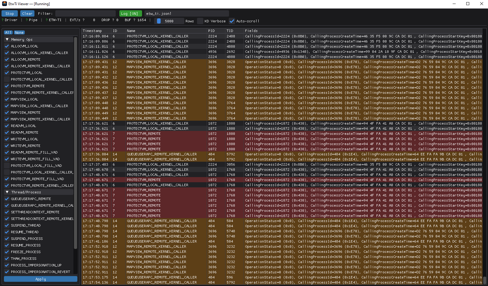

<div align="center">
  
</div>

# EtwTiViewer

A research tool for live exploration of the **Microsoft-Windows-Threat-Intelligence** (`ETW-TI`) ETW provider — the same telemetry source commercial EDRs use to detect in-memory attacks and process injection.

> **Research and education only.** Run exclusively in isolated VMs. Some parts of this project were built with LLM-assisted development and may contain bugs, be careful using this tool in production environments.

ETW-TI consumption uses an **AutoLogger** session that the kernel starts at
boot; the viewer attaches to it and detours `sechost!ControlTraceW` inside its
own process.  No kernel-mode component, kernel debugger, test-signing, or
reboot after every run is involved.




---

## What is ETW-TI?

`Microsoft-Windows-Threat-Intelligence` (GUID `{F4E1897C-BB5D-5668-F1D8-040F4D8DD344}`) is a **Secure ETW provider** built into `ntoskrnl.exe` that fires on low-level security-relevant operations:

| Keyword | What it covers |
|---|---|
| `ALLOCVM_REMOTE` / `LOCAL` | Cross-process / local virtual memory allocation |
| `PROTECTVM_REMOTE` / `LOCAL` | Protection changes (`VirtualProtectEx`, RWX marking) |
| `MAPVIEW_REMOTE` / `LOCAL` | Section mapping into another / same process |
| `QUEUEUSERAPC_REMOTE` | APC injection into a remote thread |
| `SETTHREADCONTEXT_REMOTE` | Thread register-state overwrite (shellcode injection) |
| `READVM_REMOTE` / `WRITEVM_REMOTE` | Cross-process memory read/write |
| `SUSPEND/RESUME_THREAD` | Thread suspension during injection |
| `FREEZE/THAW_PROCESS` | Whole-process freezing |
| `PROCESS_IMPERSONATION_*` | Token impersonation up / down / revert |

---

## How access works: AutoLogger + in-process detour

The kernel only enables the provider for a subscriber that is
**`PS_PROTECTED_ANTIMALWARE_LIGHT`**, backed by an ELAM certificate Microsoft
issues to commercial security vendors.  Without it, `EnableTraceEx2` returns
`ERROR_ACCESS_DENIED`.

EtwTiViewer avoids that requirement entirely:

1. `install_autologger.ps1` writes an AutoLogger key that enables
   `Microsoft-Windows-Threat-Intelligence` with all keywords.
2. At boot the **kernel** creates the session and enables the provider with no
   caller identity, so the PPL check never runs.  The kernel marks the session
   `SecurityTrace`-protected.
3. `EtwTiViewer.exe` attaches with `OpenTraceW`/`ProcessTrace`.  sechost
   internally issues `ControlTraceW(QUERY)` on the session, which is denied for
   non-PPL callers; `SecurityTrace.cpp` patches that one function in the
   viewer's own process and answers the query from a fabricated
   `EVENT_TRACE_PROPERTIES` built from the AutoLogger registry key.

The provider is enabled by the kernel at boot; the viewer only consumes the
resulting real-time session.  There is no kernel-mode component, no
test-signing, and no kernel debugger.  The detour is a user-mode modification
of the viewer's own address space and is restored on exit.

The signal path is identical to the commercial-EDR path: the kernel's
`EtwTiLog*` instrumentation writes into a real-time ETW session that this
process consumes.

---

## Architecture

```
┌──────────────────────────────────────────────────────────────────────┐
│  Kernel                                                              │
│                                                                      │
│  ntoskrnl.exe — ETW-TI instrumentation                               │
│    EtwTiLogAllocateVirtualMemory() ─────────────────────────────►    │
│    EtwTiLogProtectVirtualMemory()     ETW real-time session          │
│    EtwTiLogMapViewOfSection()         "0MyThreatIntelTrace"          │
│                                       (AutoLogger, started at boot)  │
└──────────────────────────────────────────────────────────────────────┘
                            │ real-time ETW
                            ▼
┌──────────────────────────────────────────────────────────────────────┐
│  EtwTiViewer.exe  (C++17, ImGui + DirectX 11)                        │
│                                                                      │
│  SecurityTrace  — detours sechost!ControlTraceW in this process      │
│  EtwConsumer    — OpenTraceW / ProcessTrace                          │
│                   TDH decodes PEVENT_RECORD → TiEvent                │
│  EventBuffer    — ring buffer (50 000 events)                        │
│  Render thread  — ImGui UI, JSONL file logging                       │
└──────────────────────────────────────────────────────────────────────┘
```

**Event source**

| Source | Events | Requires |
|---|---|---|
| ETW-TI consumer (user-mode) | All keyword-gated events | AutoLogger session registered by `install_autologger.ps1` |

The AutoLogger registry key lives under
`HKLM\SYSTEM\CurrentControlSet\Control\WMI\Autologger\0MyThreatIntelTrace`.

---

## Repository layout

```
EtwTiSuite/
├── EtwTiViewer/
│   ├── main.cpp             WinMain, runtime elevation, D3D11 + ImGui loop
│   ├── ImGuiApp.h/.cpp      UI: keyword panel, toolbar, event table, logging
│   ├── EtwConsumer.h/.cpp   Real-time ETW-TI consumer
│   ├── SecurityTrace.h/.cpp AutoLogger discovery + ControlTraceW detour
│   ├── Headless.h/.cpp      CLI capture mode for automation/CI
│   ├── EventBuffer.h        Thread-safe ring buffer (50 000 events)
│   └── EtwTiViewer.vcxproj
├── install_autologger.ps1   Register/remove/query the AutoLogger session
├── verify.ps1               End-to-end capture + injection-activity check
├── build.ps1                Build the viewer (Release|x64)
├── third_party/imgui/       Clone separately (see Setup)
└── EtwTiSuite.sln
```

---

## Prerequisites

| Requirement | Notes |
|---|---|
| Windows 10 21H2+ / Windows 11 x64 | Run in a VM |
| Visual Studio 2022 (v143) or 2026 (v145) Build Tools, C++ | `build.ps1` auto-detects the toolset |
| Administrator account | One-time AutoLogger registration; the viewer self-elevates on launch |
| One reboot after registration | The kernel creates AutoLogger sessions at boot |

---

## Setup

```powershell
# 1. Register the AutoLogger session (self-elevates), then reboot
powershell -ExecutionPolicy Bypass -File .\install_autologger.ps1
shutdown /r /t 0

# 2. Build the viewer (clones ImGui if needed, builds Release|x64)
powershell -ExecutionPolicy Bypass -File .\build.ps1

# 3. Confirm the session is live and protected
powershell -ExecutionPolicy Bypass -File .\install_autologger.ps1 -Status
#   Live session : PROTECTED (SecurityTrace) - ready to attach

# 4. End-to-end check: capture + provoke injection activity, assert events
powershell -ExecutionPolicy Bypass -File .\verify.ps1

# 5. Launch the GUI and click Start (it self-elevates)
.\EtwTiViewer\x64\Release\EtwTiViewer.exe
```

---

## Usage

**1. Launch the viewer** — `EtwTiViewer\x64\Release\EtwTiViewer.exe`.  The
viewer asks for elevation itself on startup, so a normal desktop launch is
enough.  The status bar shows **ETW-TI (AutoLogger)** in green when the viewer
is attached to the protected session.

> **Shared folders / network drives.**  The manifest deliberately requests
> `asInvoker`; elevation happens in `EnsureElevated()` in `main.cpp`.  The UAC
> elevation broker cannot resolve images on volume-less filesystems such as
> VirtioFS/WinFsp shares (a QEMU shared folder on `Z:`), and launching a
> `requireAdministrator` image from one fails with *"The volume does not
> contain a recognized file system"* before the process starts.  When the
> broker rejects the image with `ERROR_UNRECOGNIZED_VOLUME`, the viewer copies
> itself to `%TEMP%\EtwTiViewer\run-<id>\` and elevates that copy instead.
> UAC still applies unless the account is configured to elevate without
> prompting.

**2. Capture:**
1. Check keywords in the **Keywords** panel (or **Select All**)
2. Click **Start** — the viewer attaches to the AutoLogger session
3. Events stream into the **Events** table in real time
4. Use **Filter** to substring-match on name or any field value
5. Toggle **Log [ON]** to stream to a JSONL file
6. Hover the status indicator for a detailed tooltip
7. Click **Stop** → **Clear** to reset

Keywords selected in the UI are a **client-side filter**: the kernel-side
provider mask was fixed when the AutoLogger was created at boot.  Changing the
registry mask requires a reboot.

**Headless/CI mode:**

```powershell
.\EtwTiViewer\x64\Release\EtwTiViewer.exe --capture 30 --log out.jsonl --keywords 0x3FA5444
```

---

## Resources

- **fluxsec.red** — [ETW-TI: Rust Consumer](https://fluxsec.red/event-tracing-for-windows-threat-intelligence-rust-consumer) — detailed walkthrough of the provider, its access model, and consumer implementation
- **Sanctum** by 0xflux — [github.com/0xflux/Sanctum](https://github.com/0xflux/Sanctum) — proof-of-concept EDR in Rust demonstrating real-world ETW-TI consumption

---

## Disclaimer

Provided for defensive research and education only — to validate detection logic, evaluate ETW-TI telemetry coverage, and document provider behaviour. Using this tool against systems you do not own, or to develop evasion techniques for production environments, is outside the intended use and your sole responsibility.
